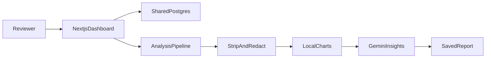

# TaskLocal Trust & Safety

An internal desk where a marketplace reviewer clears reported reviews and reads a morning briefing of what changed.

TaskLocal is a local-services marketplace. Customers and providers sometimes report a review, and someone has to decide what needs attention today without reading every comment by hand. This repository is **Product D**, the Trust & Safety dashboard. The provider, customer, and chatbot products are separate services on the same database.

## What a reviewer does

- **Dashboard** (`/`) is the daily work surface. Check whether analysis is current, open one action card, and read the executive overview.
- **Reviews** (`/reviews`) is the full catalog. Search comments, report reasons, and IDs when you need to look something up.
- **Analysis** (`/analysis`) is the full report: executive insights, what changed since the last report, charts, themes, and the high-risk case.

The morning loop is short:

1. Open **Dashboard** and read freshness: **Current**, **Analysis due**, **Generating**, or **Generation failed**. If analysis is due, generate or regenerate it.
2. Open one action card: **New reports today**, **Total unhandled reports**, or **High-risk case**. The card opens one shared report list.
3. Expand a row to read the review and the related booking. **Resolve** marks that report handled. The review stays in the catalog, and the booking is unchanged.
4. Use **Reviews** to search history, or open **Analysis** when you need the full picture.

Resolve is the only write a reviewer makes here. It lives on the dashboard report list. On Reviews, choosing **Not reported** turns off the resolution filter, because a review has to be reported before it can be handled.

## Why it is worth a look

- **One work surface.** Three action cards open a single report list, so the queue and the executive brief live on the same page.
- **Privacy before the model.** Emails, phone numbers, URLs, handles, and long digit runs are removed from free text before it is sent to Gemini, and the screen says so.
- **Numbers stay in the app.** Chart values are computed locally. Gemini writes the explanation and names the high-risk case.
- **One shared database.** The dashboard reads the marketplace Postgres from the server. It does not keep its own copy of reviews or bookings.
- **Honest request states.** Database and model calls show loading, error, and timeout. A failed analysis leaves the last good report on screen.

## How it is built

Next.js 16, React 19, TypeScript, Tailwind CSS v4, Supabase Postgres, Google Gemini, and Vitest.



The reviewer works in the Next.js dashboard. The dashboard reads the shared Postgres database. Generating analysis strips identifiers, redacts free text, computes the charts in the app, asks Gemini for the written insights, and saves the report. The last report is stored in Supabase Storage (`tasklocal-trends`), with a local file fallback so a saved analysis survives a redeploy.

## Decisions an engineer can ask about

- Service-role reads stay on the server in [`src/lib/supabase/service-role.ts`](src/lib/supabase/service-role.ts). The browser receives the publishable key for public Provider and active Listing reads. Row Level Security is on. This app does not create, alter, or drop tables. Shared tables stay capitalized: `Provider`, `Listing`, `Customer`, `Booking`, `Review`. Set `SUPABASE_SERVICE_ROLE_KEY` in `.env.local` and on the Vercel project before `005_enable_authenticated_rls.sql` runs. Smoke-test the dashboard, one resolve, Reviews, and Analysis while RLS is still off, then repeat that check after the migration.
- Free text is stripped of emails, phones, URLs, handles, and long digit runs before Gemini in [`src/lib/trends/redact.ts`](src/lib/trends/redact.ts). The UI says that. Chart numbers are computed locally. The model writes the explanation.
- Freshness uses a **9:00 AM** cutoff in `APP_TIME_ZONE` (default UTC), not a rolling 24-hour timer. A failed run leaves the last successful report in place.
- High-risk matches are server-side, case-insensitive searches on the redacted terms from the latest report. Analysis searches and labels. A reviewer resolves a review from the dashboard.
- Database columns stay `flag` and `handled`. The screen says **reported**, **unhandled**, and **resolved**. Legacy paths `/trends`, `/flagged`, and `/action-needed` redirect to the current pages.
- Database calls abort after 10 seconds. Analysis generation aborts after 90 seconds. Each call shows loading, error, timeout, or generating.

## Run it

You need Node.js, this folder, and keys from the person who owns the TaskLocal Supabase project. Keep private keys out of email, chat, and git.

1. Install dependencies with `npm install`.
2. Copy the template: `cp .env.local.example .env.local`.
3. Fill in the Supabase URL (prefilled in the example), the publishable key, and the server-only service-role key. Never prefix `SUPABASE_SERVICE_ROLE_KEY` with `NEXT_PUBLIC_` or `VITE_`, and never commit the real value.
4. Start the app with `npm run dev`.
5. Open [http://localhost:3000](http://localhost:3000).

Optional environment variables, using the same names locally and on Vercel:

- `APP_TIME_ZONE` — IANA timezone for “new reports today” and the 9:00 AM freshness cutoff. Unset or invalid values use `UTC`. Example: `America/New_York`.
- `GEMINI_API_KEY` — server-only Google AI Studio key for analysis. It wins over `GOOGLE_API_KEY` when both are set. Optional `GEMINI_MODEL` locks a single model; otherwise the app tries `gemini-3.1-pro-preview`, then free fallbacks.
- `DASHBOARD_API_SECRET` — only if you call the optional HTTP proxies (`GET /api/flagged-reviews`, `POST /api/reviews/[id]/resolve`). The dashboard UI does not call them. They return 503 when this secret is unset.

Scripts:

- `npm run dev` — development server
- `npm run build` — production build
- `npm run start` — production server
- `npm run lint` — ESLint
- `npm test` — offline Vitest suite. It does not need Supabase or `.env.local`.

## Where to go next

```
src/
  app/            # /, /reviews, /analysis, Resolve, optional API proxies
  components/     # dashboard, reviews, analysis, charts, shared status UI
  lib/queries/    # database reads and timeouts
  lib/reviews/    # catalog URL params, dates, pagination
  lib/trends/     # freshness, redaction, local charts, Gemini, saved reports
  lib/supabase/   # publishable client and server-only service role
  lib/dashboard/  # dashboard URL params and labels
```

The full product spec is [docs/PRD.md](docs/PRD.md).
